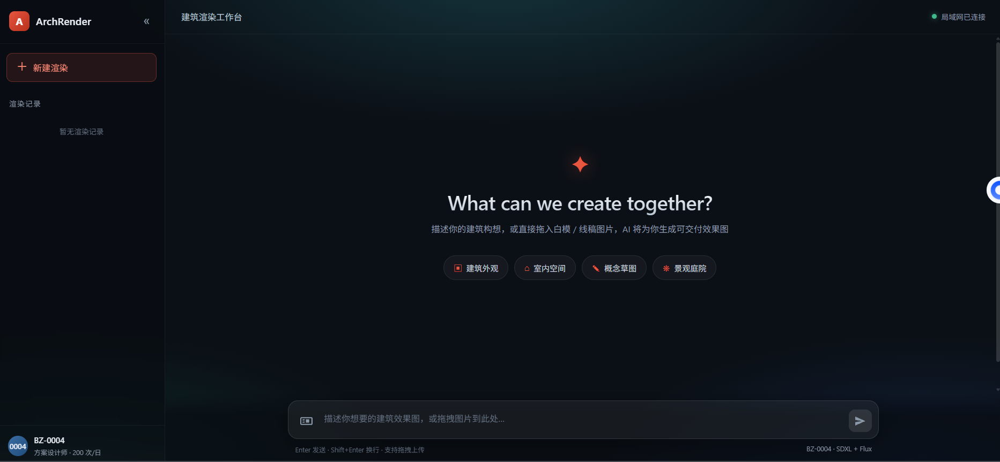

# Architectural Rendering Chain

> 建筑渲染图像生成 Agent —— 将建筑白模/线稿/深度图自动转化为可交付效果图的确定性多阶段生成链路。
> 局域网多用户部署，设备指纹自动登录，按角色隔离数据。

## 界面预览



<details>
<summary>界面功能说明</summary>

- **左侧栏**：渲染记录列表（`GET /api/tasks`），点击任一条加载该次完整对话；左下角显示后端分配的工人 ID（如 `BZ-0004`）与角色配额
- **中央区**：Hero 空状态 + 四个快捷标签（建筑外观 / 室内空间 / 概念草图 / 景观庭院）
- **底部**：支持拖拽上传的输入框；对话中的任意图片（用户上传图、候选图、最终结果）均可点击"引用"再次作为输入
- **顶部**：连接状态指示（局域网已连接 / 未连接）

</details>

## 核心特性

- **结构可控**：ControlNet 接收线稿 / 深度 / 法线三类条件图，解决建筑效果图"透视错乱、构件变形"问题
- **风格可沉淀**：基于历史效果图微调 SDXL 风格 LoRA（rank=32、bf16），权重仅几十 MB，可按项目热切换
- **人工在环**：多候选初稿经人工审批后才进入精修，避免无效算力消耗
- **全链路本地化**：模型权重本地部署，客户图纸不出内网
- **局域网多用户**：设备指纹自动登录、来源 IP 白名单、按角色/用户/任务三级隔离存储
- **工程化交付**：FastAPI 服务化 + SSE 进度推送 + Vue3 界面 + Docker Compose 一键部署

> **部署边界**：本系统仅供局域网使用，不面向公网。

## 生成链路

```
输入(提示词+图片)
    │
    ▼
[1] LLM 提示词优化 (Qwen3-32B / vLLM)
    │
    ▼
[2] ControlNet 条件图生成 (Canny线稿 / DepthAnything-v2深度 / 法线)
    │
    ▼
[3] SDXL 1.0 多候选初稿 (batch_size=4, ControlNet结构控制 + 风格LoRA)
    │
    ▼
[4] 人工审批卡点 (HITL) ← 设计师选择或标注修改意见
    │
    ▼
[5] Flux.1-dev 精修 (img2img, denoise=0.45, 输出2048×2048)
    │
    ▼
[6] 后处理与交付 (Pillow色彩校正 → 存储 → SSE done事件)
```

**为何是 Pipeline 而非多 Agent**：图像生成步骤为固定 DAG，无动态分支需求；引入 LLM 动态规划只会增加延迟与不确定性。节点内的 LLM 提示词优化与深度估计都是确定性转换，无决策权、无路由、无循环。

## 多用户安全架构

| 层级 | 机制 | 实现 |
|---|---|---|
| 网络层 | 来源 IP 白名单 | 中间件仅允许 `127/8`、`10/8`、`172.16/12`、`192.168/16` |
| 身份层 | 设备指纹自动登录 | 前端生成 `dev_xxx` 存 localStorage，请求带 `X-Device-Id`；后端自动注册分配 `BZ-XXXX` |
| 数据层 | 三级目录隔离 | `outputs/{role}/{user_id}/{task_id}/`，`/api/files/` 校验路径归属 |

角色：designer（方案设计师，200 次/日）、reviewer（方案审核，50 次/日）、admin（管理员，1000 次/日）。

## 快速开始

```bash
# 1. 克隆仓库
git clone https://github.com/wudidekongjv/architectural-rendering-chain.git
cd architectural-rendering-chain

# 2. 下载模型权重（本仓库不含模型文件，仅提供下载地址）
bash scripts/download_models.sh --all

# 3. 启动服务
cd docker && docker compose up -d

# 4. 局域网内访问前端
# http://<服务器IP>:5173
```

首次打开自动注册设备并在左下角显示分配的 ID（如 `BZ-0004`）。

详见 [部署文档](docs/DEPLOYMENT.md) 与 [模型清单](docs/MODEL_DOWNLOADS.md)。

## 仓库结构

```
├── docs/
│   ├── images/frontend-preview.png   # 界面截图
│   ├── DEPLOYMENT.md                 # 局域网多用户部署
│   ├── MODEL_DOWNLOADS.md            # 模型下载地址
│   └── DATASET.md                    # 训练数据说明
├── src/
│   ├── prompt_optimizer.py           # LLM 提示词优化
│   ├── controlnet_builder.py         # ControlNet 条件图生成
│   ├── comfyui_client.py             # ComfyUI API 客户端
│   ├── pipeline.py                   # 单线 Pipeline 编排
│   └── api/main.py                   # FastAPI 鉴权 + SSE + 多用户接口
├── workflows/                        # ComfyUI 工作流 JSON
├── web/                              # Vue3 前端（设备指纹 + 拖拽上传 + 图片引用）
├── docker/                           # Dockerfile + docker-compose
├── scripts/                          # 模型下载 / LoRA 训练脚本
├── data/                             # 训练数据（140张效果图 + 英文标签txt）
└── examples/                         # 示例输出
```

## 前后端接口对照

| UI 功能 | 后端接口 |
|---|---|
| 设备自动登录 / 左下角 ID | `POST /api/auth/register`、`GET /api/auth/me` |
| 渲染记录列表 / 详情 | `GET /api/tasks`、`GET /api/tasks/{id}` |
| 提交渲染 | `POST /api/v1/render` |
| 候选图审批 | `POST /api/v1/render/{id}/approve` |
| 进度 / 结果推送 | `GET /api/v1/render/stream`（SSE） |
| 图片显示 / 下载 / 引用 | `GET /api/files/{path}` |

## 训练数据

`data/` 目录包含 140 张建筑效果图及对应的英文标签 `.txt`（与图片同名）。标签由视觉识别生成，覆盖建筑类型、风格、视角、材质、光照、时间、环境、配色、构图等 12+ 维度，可直接用于 kohya_ss / SD-Trainer 的 LoRA 训练。

```bash
cat docs/DATASET.md
```

## LoRA 训练

```bash
# 使用 kohya_ss 训练风格 LoRA（不在此仓库内执行）
bash scripts/train_lora.sh
```

关键参数：rank=32、alpha=16、learning_rate=1e-4、bf16 混合精度、单卡 RTX 4090 24GB、约 1500–3000 steps。

## 模型许可

本仓库**不包含任何模型权重文件**，仅提供官方下载地址。请遵守各模型的许可证使用。详见 [MODEL_DOWNLOADS.md](docs/MODEL_DOWNLOADS.md)。

## License

MIT
